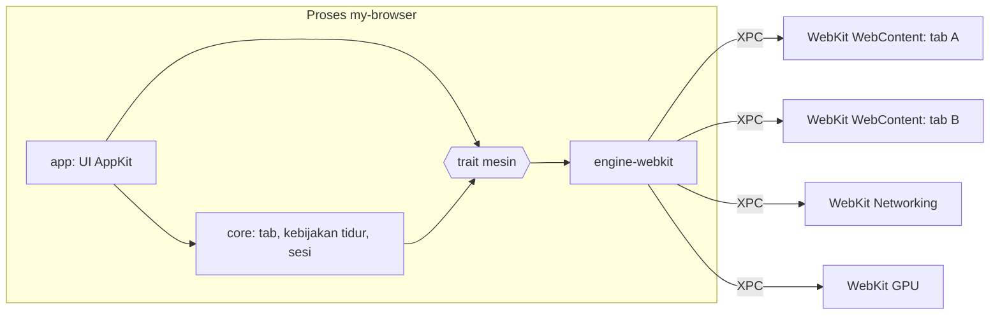
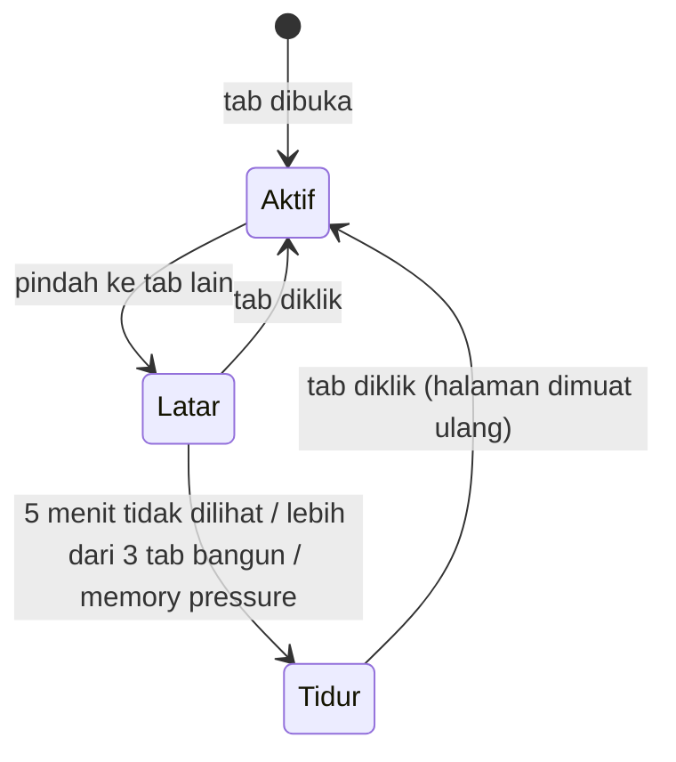

# Desain: Browser Hemat Memory (Rust + WebKit, macOS)

Tanggal: 2026-11-15
Status: draf, menunggu persetujuan pengguna
Nama kerja: `my-browser`

Penanda **(usulan)** berarti keputusan dibuat penulis desain dan belum dikonfirmasi pengguna. Bagian tanpa penanda sudah diputuskan pengguna dalam diskusi.

## 1. Latar belakang

Pengguna memakai Chrome, dan pemakaian memory-nya besar. Hasil pengukuran di Mac pengguna (arm64, RAM 16 GB, macOS 15.7.7) pada 15 November 2026 dengan `ps -axo rss,args`, difilter "Google Chrome":

| Pengukuran | Proses Chrome | Total RSS |
|---|---|---|
| Pertama | 29 | sekitar 4,4 GB |
| Kedua | 17 | sekitar 2,4 GB |

Rincian pengukuran kedua: renderer tab 1.415 MB (8 proses, rata-rata 177 MB per tab), proses utama 469 MB, GPU 169 MB, satu proses extension 120 MB, layanan utility 256 MB. RSS menghitung memory bersama lebih dari sekali, jadi angka ini lebih besar dari pemakaian sebenarnya.

Browser baru ini khusus untuk menonton YouTube dan browsing santai. Untuk kerja, pengguna tetap memakai browser lain. Karena itu browser ini tidak perlu kompatibel dengan extension Chrome atau sync akun Google.

## 2. Tujuan, bukan tujuan, anti-tujuan

Tujuan:

1. YouTube berjalan normal: video bisa diputar, layar penuh berfungsi, dan login akun Google/YouTube tersimpan.
2. Browsing biasa: tab, address bar yang menerima URL atau kata kunci pencarian, back, forward, reload.
3. Pemakaian RAM jauh di bawah Chrome pada skenario yang sama (target di bagian 6).
4. Mesin render bisa diganti ke Servo nanti tanpa menulis ulang UI dan logika tab.

Bukan tujuan versi pertama **(usulan)**:

- Extension, sync akun, bookmark, riwayat global, mode private, Picture-in-Picture, find in page.
- Windows dan Linux.
- Situs streaming berproteksi DRM (Netflix, Disney+, Spotify web). Yang ini dikonfirmasi pengguna: tidak dibutuhkan.
- Memblokir iklan di dalam video YouTube. Iklan ini dikirim dari domain yang sama dengan videonya, jadi pemblokiran berbasis daftar alamat tidak menangkapnya, dan cara menembusnya terus berubah.
- Mengerjakan Servo itu sendiri. Yang disiapkan hanya batas kode supaya Servo bisa dipasang.

Anti-tujuan **(usulan)** (dianggap gagal walaupun secara teknis jalan):

- Tab yang sedang memutar video atau audio ikut ditidurkan, sehingga tontonan terputus.
- Total pemakaian memory pada perbandingan utama di bagian 6 tidak lebih rendah dari Safari. Kalau begitu hasilnya, pengguna lebih baik memakai Safari.
- Situs rusak karena pemblokir iklan dan tidak ada cara mematikan pemblokir untuk situs itu.
- Tab yang ditidurkan kehilangan alamatnya atau tidak bisa dibangunkan.

## 3. Batasan

- Hanya macOS, Apple Silicon (arm64). Target minimum macOS 14 **(usulan)**. API yang dipakai tersedia sejak macOS 12.3, jadi batas ini boleh diturunkan kalau perlu.
- Mesin render: WebKit sistem lewat `WKWebView`. Tidak membundel mesin sendiri.
- Rust belum terpasang di mesin pengguna. Xcode sudah ada di `/Applications/Xcode.app`, jadi SDK dan linker tersedia. Homebrew ada di `/opt/homebrew`.
- Untuk pemakaian pribadi: dikemas sebagai `.app` dengan ad-hoc codesign, tanpa App Store dan tanpa notarisasi.
- AppKit dan WebKit hanya boleh dipanggil dari main thread.

## 4. Pendekatan yang dipertimbangkan

| Pendekatan | Kelebihan | Kekurangan |
|---|---|---|
| **1. Rust + WebKit, UI native AppKit via `objc2`** (dipilih) | Paling hemat: UI tidak memakai proses web. Semua pengaturan WebKit bisa diakses langsung. Video YouTube memakai dekoder hardware. | Hanya macOS. Kode lebih banyak karena memanggil API Apple langsung. |
| 2. Rust + WebKit via `wry`/`tao` | Lebih cepat sampai ke versi yang jalan, bisa lintas platform. | Tab bar biasanya HTML, sehingga UI memakai satu proses web tambahan (puluhan MB). Pengaturan memory WebKit tetap harus diakses lewat API macOS. |
| 3. Rust + Servo | Rust sampai ke mesinnya. | Per November 2026 Servo belum punya Media Source Extensions (MSE), padahal YouTube mengalirkan semua videonya lewat MSE. Dukungan awal MSE baru mulai dikerjakan tim Servo dengan hibah NLnet sejak Juni 2026. Servo juga belum tentu lebih hemat dari WebKit untuk halaman yang sama. |

Pengguna memilih pendekatan 1 dengan syarat kode dirancang supaya mesinnya bisa diganti ke Servo setelah Servo mampu memutar YouTube.

Sumber status Servo: [NLnet Servo Multimedia](https://nlnet.nl/project/Servo-multimedia/), [PR MSE di proyek eclipse](https://github.com/Pryancito/eclipse/pull/2417), [PR di proyek Berick](https://github.com/RexGuard/Berick/pull/2).

## 5. Desain

### 5.1 Struktur kode

Cargo workspace dengan tiga crate **(usulan)**:

- `crates/core`: model tab, kebijakan tidur, penguraian input address bar, penyimpanan sesi, dan trait mesin. Tidak bergantung pada macOS, bisa diuji dengan `cargo test` biasa.
- `crates/engine-webkit`: implementasi trait mesin di atas `WKWebView` lewat `objc2-web-kit`.
- `crates/app`: binary dan UI AppKit (window, toolbar, tab strip). Menyambungkan `core` dengan mesin.

Aturan batas: `core` dan logika di `app` hanya bicara ke mesin lewat trait. Satu-satunya yang boleh lewat dari mesin ke UI adalah view native (`NSView`) untuk ditempel ke window. Servo nanti masuk sebagai crate `engine-servo` yang juga menyediakan `NSView`.



WebKit sendiri yang menentukan pembagian proses WebContent. "Satu proses per tab" di diagram hanya gambaran kasar.

Sketsa trait. Builder boleh mengubah bentuknya selama aturan batas di atas terjaga:

```rust
pub trait Engine {
    type Page: Page;
    fn create_page(&self, events: EventSink) -> Self::Page;
}

pub trait Page {               // melepas Page (Drop) = melepas memory halamannya
    fn load(&self, url: &Url);
    fn back(&self);
    fn forward(&self);
    fn reload(&self);
    fn stop(&self);
    fn query_media_playing(&self, done: Box<dyn FnOnce(bool)>);
    fn query_scroll_y(&self, done: Box<dyn FnOnce(f64)>);
    fn native_view(&self) -> NativeView;
}

pub enum PageEvent { UrlChanged(Url), TitleChanged(String), Progress(f32), OpenInNewTab(Url) }
```

### 5.2 Penidur tab

Penghematan terbesar datang dari sini. Pada pengukuran Chrome, renderer tab memakai 58% dari total.



- **Aktif**: tab yang sedang dilihat. **Latar**: masih bangun tapi tidak dilihat. **Tidur**: `WKWebView` dilepas. Yang disimpan hanya URL, judul, dan posisi scroll.
- Aturan bawaan **(usulan)**:
  - Tab latar ditidurkan setelah 5 menit tidak dilihat.
  - Paling banyak 3 tab bangun sekaligus (aktif + 2 yang terakhir dilihat). Kalau ada tab keempat yang bangun, tab latar yang paling lama tidak dilihat langsung ditidurkan.
  - Saat macOS mengirim sinyal memory pressure (warning atau critical), semua tab latar langsung ditidurkan. Sinyal diterima lewat dispatch source memory pressure (crate `dispatch2`).
- Pengecualian: tab yang sedang memutar media (`WKWebView requestMediaPlaybackState`) atau sedang memakai kamera/mikrofon tidak ditidurkan, apa pun aturannya.
- Bangun: saat tab diklik, `WKWebView` baru dibuat, URL dimuat, lalu posisi scroll dikembalikan setelah halaman selesai dimuat.
- YouTube **(usulan)**: sebelum tab `youtube.com/watch` ditidurkan, posisi video dibaca (`currentTime` elemen `video`) dan disimpan ke parameter `t=` di URL, supaya saat dibangunkan video lanjut dari posisi yang sama.
- Batas yang diterima: isi form yang belum dikirim hilang saat tab tidur.
- Logika keputusan dibuat murni di `core`. Inputnya daftar tab, waktu sekarang, status media, dan status memory pressure. Outputnya daftar tab yang harus ditidurkan. Jam diinjeksi supaya bisa diuji tanpa menunggu.

### 5.3 Pemblokir iklan dan tracker

- Memakai `WKContentRuleListStore`. Aturan dalam format JSON content blocker Safari dikompilasi WebKit sekali, disimpan di disk, dan dipakai semua tab tanpa proses tambahan. Ini pengganti extension 120 MB yang terukur di Chrome.
- Sumber aturan: EasyList dan EasyPrivacy, dikonversi ke format WebKit dengan crate `adblock` (fitur `content-blocking`). Hasil JSON dibundel di aplikasi. Pembaruan daftar dilakukan manual di versi pertama **(usulan)**.
- WebKit membatasi jumlah aturan per daftar. Angka batasnya belum dicek. Kalau aturan melebihi batas, pecah menjadi beberapa daftar.
- Pengecualian per situs: menu "Matikan pemblokir untuk situs ini". Daftar situs yang dikecualikan disimpan dan diterapkan ke semua tab. Mekanismenya diserahkan ke builder.

### 5.4 Kebutuhan khusus YouTube

- Layar penuh: aktifkan `WKPreferences.isElementFullscreenEnabled` (macOS 12.3+). Tanpa ini tombol layar penuh YouTube tidak berfungsi.
- User agent: user agent bawaan `WKWebView` tidak memuat penanda `Version/... Safari/...`. Login Google dan sebagian situs bisa menolak atau memberi versi terbatas. Isi `applicationNameForUserAgent` supaya user agent sama dengan Safari di versi macOS yang sama.
- Satu `WKWebsiteDataStore` persisten dipakai bersama semua tab, supaya cookie login tersimpan antar sesi.
- Codec dipilih YouTube sendiri sesuai kemampuan chip. WebKit memakai dekoder hardware. Tidak ada pekerjaan khusus di sini.

### 5.5 Fitur browser versi pertama

- **Satu window** dengan satu webview yang terlihat. Pengguna mengonfirmasi tidak perlu menonton video sambil membuka halaman lain di jendela kedua. Tab strip sederhana dari komponen AppKit di bawah toolbar. Tab bawaan macOS (`NSWindow` tabbing) tidak dipakai karena di sana setiap tab adalah satu window, dan memory yang dipakai window tersembunyi belum diukur.
- Tab tidur diberi tanda visual di tab strip. Bentuk tandanya diserahkan ke builder.
- Toolbar: back, forward, reload/stop, address bar.
- Address bar: input yang punya skema (`http://`, `https://`) atau mirip domain (ada titik, tanpa spasi) dimuat sebagai URL, dengan `https` sebagai default. Selain itu dicari di mesin pencari. Mesin pencari bawaan Google **(usulan)**, bisa diganti lewat konfigurasi.
- Link `target=_blank` dan `window.open` dibuka sebagai tab baru. WebKit mewajibkan webview baru dibuat dengan konfigurasi yang diberikan di `WKUIDelegate`.
- Shortcut: Cmd+T, Cmd+W, Cmd+L, Cmd+R, Cmd+[, Cmd+], Cmd+Shift+T (buka lagi tab yang baru ditutup), Cmd+1 sampai Cmd+9, Ctrl+Tab.
- Sesi **(usulan)**: saat aplikasi ditutup, daftar tab (URL, judul, posisi scroll) disimpan sebagai JSON di `~/Library/Application Support/my-browser/`. Saat dibuka lagi, semua tab kembali dalam keadaan tidur kecuali tab yang terakhir aktif.
- Download minimal **(usulan)**: berkas disimpan ke `~/Downloads` lewat `WKDownload`, tanpa UI pengelola download. Pengguna diberi tahu saat download selesai.

### 5.6 API privat WebKit **(usulan)**

API privat WebKit (nama berawalan garis bawah, misalnya `_WKProcessPoolConfiguration` dan setter privat di `WKPreferences`) boleh dipakai, tapi hanya untuk pengaturan memory: cache proses, proses prewarmed, cache back/forward proses yang ditangguhkan, dan batas jumlah proses.

- Alasan: aplikasi ini untuk pemakaian pribadi dan tidak lewat review App Store. Pengaturan proses WebKit yang relevan diduga hanya tersedia lewat API privat (belum dicek satu per satu).
- Setiap panggilan dicek dulu dengan `respondsToSelector:`. Kalau tidak tersedia, aplikasi tetap jalan dengan perilaku bawaan WebKit.
- Semua panggilan privat dikumpulkan di satu modul di `engine-webkit`, supaya mudah diperiksa ulang setelah update macOS.

## 6. Kriteria sukses dan cara mengukur

Skenario uji **(usulan)**: 1 tab YouTube memutar video 1080p dan 5 tab situs umum (daftar URL tetap, disimpan di script ukur). Diukur 10 menit setelah semua tab dibuka, tanpa menyentuh tab selain YouTube.

Skenario dijalankan bergantian di Chrome, Safari, dan `my-browser`, dengan hanya satu browser yang hidup setiap kali. Ada dua perbandingan **(usulan)**:

- **Perbandingan utama (penentu lulus/gagal).** Setiap browser memakai perilaku yang akan dialami pengguna sehari-hari. `my-browser` dengan penidur tab aktif. Safari bawaan tanpa content blocker. Chrome dengan profil asli pengguna (termasuk extension-nya) dan pengaturan yang sedang dipakai; status Memory Saver dicatat. Alasannya, tujuan pengguna adalah memory lebih kecil saat dipakai, bukan membuktikan satu mesin lebih ringan dari mesin lain.
- **Perbandingan tambahan (informasi, bukan penentu).** `my-browser` dengan penidur tab dimatikan, sehingga semua tab bangun, dibandingkan Safari dengan tab yang sama. Gunanya untuk melihat beban dasar UI dan pemblokir di luar efek penidur tab. Pengukuran ini dijalankan sekali di awal pada prototipe minimal (satu window, satu `WKWebView`), sebelum UI lengkap dibangun.

Alat ukur: script `scripts/ukur-memory.sh` yang menjumlahkan physical footprint (`/usr/bin/footprint`, setara kolom Memory di Activity Monitor) proses aplikasi beserta proses WebKit miliknya. Footprint dipakai sebagai pengganti RSS supaya memory bersama tidak dihitung ganda. Angka Chrome di bagian 1 diukur dengan RSS, jadi harus diukur ulang dengan script ini.

Target **(usulan, ditinjau ulang setelah pengukuran pertama)**:

| Ukuran | Target |
|---|---|
| Total `my-browser` dibanding Chrome | paling banyak 50% |
| Total `my-browser` dibanding Safari | lebih rendah |
| Proses aplikasi saja (tanpa proses WebKit) | paling banyak 100 MB |
| Proses WebContent untuk tab tidur | tidak ada setelah tab tidur |

## 7. Pengujian

- `core`: unit test untuk kebijakan tidur (urutan, batas 3 tab bangun, pengecualian media, memory pressure), penguraian input address bar, dan serialisasi sesi.
- `engine-webkit` dan `app`: uji manual dengan daftar cek: video YouTube berputar, layar penuh, login tersimpan setelah restart, tab tidur lalu bangun di posisi yang benar, pemblokir aktif, pengecualian per situs berfungsi, download tersimpan. Ditambah script ukur memory dari bagian 6.

## 8. Risiko dan hal yang belum terverifikasi

- **Login Google di `WKWebView` belum dites.** Google diketahui menolak login dari sebagian webview tertanam. Penyamaan user agent dengan Safari diduga cukup, tapi belum terbukti. Ini dites paling awal, sebelum fitur lain dibangun. Kalau gagal, pekerjaan berhenti dan keputusan kembali ke pengguna (misalnya YouTube tanpa login). Pengguna login dengan password dan kode di HP, bukan passkey atau security key, jadi tes ini cukup memakai alur password biasa.
- **Melepas `WKWebView` belum tentu langsung menghentikan proses WebContent-nya.** WebKit menyimpan proses cadangan (prewarmed) dan cache proses, sehingga memory bisa tidak langsung turun. Ini harus diukur, bukan diasumsikan.
- **Atribusi proses WebKit ke aplikasi.** Proses `com.apple.WebKit.*` dijalankan lewat XPC, sehingga parent process-nya bukan aplikasi kita. Aplikasi sistem lain (Mail, Notes, dan lainnya) juga memakai WebKit. Script ukur perlu cara yang andal untuk memilih proses milik `my-browser`.
- **Batas jumlah aturan content blocker** dan lama kompilasi pertamanya belum dicek.
- **Cakupan binding `objc2-web-kit` 0.3.2.** Fitur crate `WKContentRuleListStore`, `WKDownload`, `WKPreferences`, `WKUserContentController`, `WKWebView`, dan `WKWebViewConfiguration` ada di daftar fitur crate (dicek di crates.io, 15 November 2026). Metode spesifik seperti `requestMediaPlaybackState` belum dicek satu per satu.

Versi crate yang tercatat di crates.io pada 15 November 2026: `objc2` 0.6.5, `objc2-app-kit` 0.3.2, `objc2-web-kit` 0.3.2, `objc2-foundation` 0.3.2, `block2` 0.6.2, `dispatch2` 0.3.1, `adblock` 0.13.5.

## 9. Diserahkan ke builder

- Bentuk persis trait mesin dan tipe event.
- Nama crate, struktur modul, dan penanganan error.
- Cara konversi EasyList (build script atau perintah terpisah) dan pemecahan daftar aturan.
- Cara mengemas `.app` (`cargo-bundle` atau script manual dengan `Info.plist` dan ad-hoc codesign).
- Desain tab strip dan tanda tab tidur.
- Cara atribusi proses WebKit di script ukur.
- Nilai waktu penidur tab setelah diukur, dan apakah tab YouTube yang di-pause boleh ditidurkan.
- Riwayat back/forward setelah tab bangun (versi pertama boleh hilang).
- Konfigurasi lewat berkas atau jendela pengaturan.
- Apakah YouTube dikecualikan dari pemblokir secara bawaan.
- Cara jendela pop-up diserahkan lewat trait mesin.
- Penyimpanan sesi saat aplikasi crash.

## 10. Tidak dicakup dokumen ini

- Mesin Servo dan cara menempelkannya. Yang disiapkan hanya batas trait di bagian 5.1.
- Fitur di daftar "bukan tujuan versi pertama". Dibahas setelah versi pertama dipakai sehari-hari.
- Rilis untuk orang lain (notarisasi, pembaruan otomatis).
