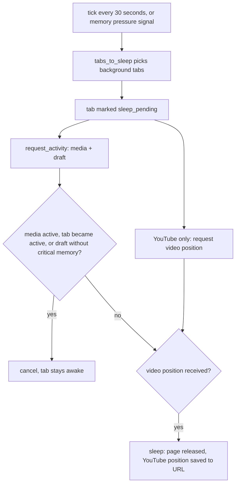

# Tab sleep

Background tabs that have not been viewed for a long time are put to sleep: their WKWebView is released, which also releases the WebContent process and its memory. The tab stays in the sidebar (dimmed, with a moon icon, `crates/app/src/sidebar_row.rs`) and reloads when opened. Sleep is different from unloading a pinned tab: a sleeping tab keeps its current page and scroll position (see [`sidebar.md`](sidebar.md)).

Task 9 measurements (`docs/testing/measurements.md`): four awake tabs used 399.0 MB. After three background tabs were put to sleep, the total dropped to 122.9 MB.

## When a tab sleeps

- **Not viewed for 30 minutes.** The default `sleep_idle_secs` is 1800 (`crates/core/src/sleep.rs:28`). The check runs every 30 seconds (`crates/app/src/timer.rs:11`), so a tab can fall asleep up to 30 seconds after its limit.
- **Too many awake tabs.** If more than 5 tabs are awake (`max_awake`, including the active tab), the background tab that has gone longest without being viewed is put to sleep right away, without waiting 30 minutes. This limit is enforced immediately on every tab switch (`crates/core/src/browser.rs:506`).
- **macOS is low on memory.** When macOS sends a memory pressure signal (Warning or Critical, `crates/app/src/memory_pressure.rs`), all eligible background tabs are put to sleep right away, whatever their timer says (`crates/core/src/sleep.rs:50`).
- **Requested through MCP.** The `sleep_tab` tool puts one background tab to sleep under the same protection rules.

## What does not sleep

- The active tab.
- Tabs that are playing audio or video, using the camera or microphone, downloading, or showing a JavaScript dialog (`crates/engine-webkit/src/page.rs:59`, `:187`). Paused video does not count, but its position is saved for YouTube (see below).
- Tabs with **text that has been typed but not yet submitted**, except when memory is critical (`crates/core/src/sleep.rs:46`, `crates/core/src/browser.rs:364`).

Protected tabs still count toward the limit of 5 awake tabs. As a result, other unprotected background tabs may sleep sooner.

## Unsubmitted text

A reloaded page loses its form contents, so tabs with an unsubmitted comment, message, or form input are kept awake.

How it is detected (`crates/core/src/draft_tracker.js`):

- Only real user typing counts, meaning `input` events with `isTrusted` (line 31). Values filled in by page scripts or the password filler do not count.
- Watched fields: textareas, `contenteditable` editors (Gmail, X, Slack, YouTube comment boxes), and single-line fields of type text, search, email, URL, telephone, or number (line 10). Password fields do not count.
- A draft is considered finished when the form is submitted (line 37), Enter is pressed in a single-line field (line 45), the field is emptied, or the field disappears from the page (for example, the Gmail compose box that closes after sending).
- A single-line field that is left behind because the page address changed does not count (line 60). For example, typing in the YouTube search box and then picking a suggestion without pressing Enter. Textareas and editors still count even when the address changes.

The tracker runs in the same content world as the password script (`crates/engine-webkit/src/scripts.rs:54`), so page scripts cannot see or modify it. The text itself never leaves the page: the browser only asks "is there still a draft?" and receives `true` or `false` (`crates/core/src/drafts.rs:13`).

**When drafts are still put to sleep:** only when macOS reports **Critical** memory. At the Warning level, tabs with drafts are left awake, while other background tabs are still put to sleep. The reasoning: lost text cannot be recovered, but one tab's memory can.

**Side effect:** according to the tracker logic, an editor that saves automatically but keeps its text after typing (for example Notion) keeps its tab awake for as long as the page is open. This has not been tried on a real site. Only memory is sacrificed, not data.

## Sleep flow

The media and draft queries run at the same time, and the `Activity` event is sent once both have answered (`crates/engine-webkit/src/page.rs:187`). The tab only actually sleeps after that answer says it is safe and, for YouTube, the video position has been received (`crates/core/src/browser.rs:300`).

## When the tab is opened again

The page reloads from its address.

What is kept:

- **Login.** Cookies are stored in a persistent data store (`crates/engine-webkit/src/page.rs:94`).
- **Scroll position.** Saved when you leave the tab (`crates/core/src/browser.rs:500`) and restored after the page finishes loading (`crates/core/src/browser.rs:342`).
- **YouTube video position**, including paused videos. The position is requested right before the tab sleeps (`crates/core/src/browser.rs:290`) and saved as `t=<seconds>s` in the tab address (`crates/core/src/browser.rs:550`, `crates/core/src/youtube.rs:25`).

What is lost:

- Dynamically loaded content, for example a feed that was scrolled a long way. The scroll position is restored, but the content may not load that far down.
- Web app state that is not stored in the address, for example filters or open panels.
- Video position on sites other than YouTube.
- Unsubmitted text, if the tab was put to sleep because memory was critical.
- Reload time, usually a few seconds depending on the site.

## Settings (`settings.json`)

| Key | Default | Purpose |
|---|---|---|
| `sleep_idle_secs` | `1800` | Background tabs sleep after this many seconds without being viewed |
| `max_awake` | `5` | Maximum number of awake tabs, including the active tab (minimum 1, `crates/core/src/settings.rs:65`) |

File location: `~/Library/Application Support/my-browser/settings.json`. Quit the browser first (⌘Q) before editing, because the browser can overwrite the file with old values when it saves other settings.

Until 2026-11-21 the defaults were 300 seconds and 3 tabs. Those values were too strict for daily use: tabs left alone briefly had to reload. The real memory protection comes from the macOS memory pressure signal, not from the timer.

## Code

- `crates/core/src/sleep.rs`: policy for choosing which tabs sleep (pure functions, no side effects).
- `crates/core/src/browser.rs`: sleep and wake flow, `tick`, `request_sleep`, handling of the `Activity` event.
- `crates/core/src/drafts.rs` and `draft_tracker.js`: tracker for unsubmitted text.
- `crates/core/src/youtube.rs`: YouTube video position in the tab address.
- `crates/engine-webkit/src/page.rs`: `request_activity` (media state from WebKit and the draft query).
- `crates/app/src/timer.rs` and `memory_pressure.rs`: periodic tick trigger and the memory signal from macOS.

Tests: `crates/core/src/sleep.rs:94` and `:103`, `crates/core/src/browser.rs:714`, `:734`, `:744`, and the `drafts` section of the WebKit smoke test (`crates/engine-webkit/tests/smoke.rs:539`). That smoke test checks 11 states with a real WKWebView, including that values filled in by page scripts do not count and that the tracker is not visible to the page.

## Not yet verified

- Typing is tested with `execCommand('insertText')`, which goes through the WebKit editing path and produces `isTrusted` events like a keyboard does. This applies to both the smoke test and the app E2E test (a tab with a comment does not sleep through `sleep_tab`, then sleeps after the comment is emptied). Typing directly with a keyboard on real sites (YouTube, Gmail) has not been tried and is on the manual checklist (`docs/testing/manual-checklist.md`, Task 9 items g through j).
- The critical memory path has only been tested with unit tests, not with `sudo memory_pressure -S -l critical`.
- Resuming a YouTube video after the tab wakes is tested with unit tests. The manual check on real YouTube (item c) has not been ticked.

## Out of scope

- **Forms inside iframes**, for example Disqus comment boxes or embedded forms. The tracker is only installed in the main frame (`crates/engine-webkit/src/scripts.rs:41`), so drafts in iframes are not detected and the tab may sleep.
- **Memory measurements with the new defaults.** The numbers at the top of this document come from a test with `sleep_idle_secs` 20 and have not been repeated for 1800 seconds and 5 tabs.
