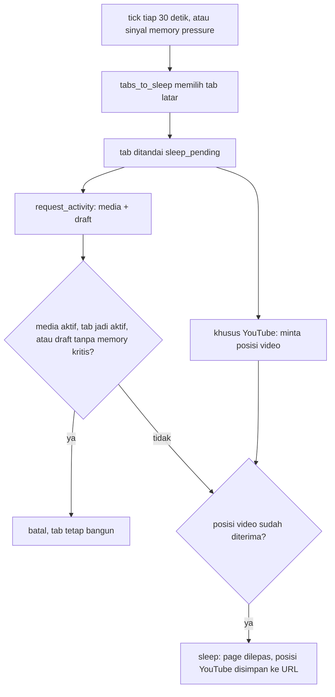

# Tab tidur

Tab latar yang lama tidak dilihat ditidurkan: WKWebView-nya dilepas, sehingga proses WebContent dan memory-nya ikut dilepas. Tab tetap ada di bilah tab (redup, dengan tooltip "Tidur, dimuat ulang saat dibuka", `crates/app/src/tab_strip.rs:78`) dan dimuat ulang saat dibuka.

Hasil ukur Task 9 (`docs/testing/hasil-ukur.md`): empat tab bangun memakai 399,0 MB. Setelah tiga tab latar ditidurkan, angkanya turun menjadi 122,9 MB.

## Kapan tab ditidurkan

- **Tidak dilihat 30 menit.** Bawaan `sleep_idle_secs` adalah 1800 (`crates/core/src/sleep.rs:28`). Pengecekan berjalan setiap 30 detik (`crates/app/src/timer.rs:11`), jadi tab bisa tidur sampai 30 detik lebih lambat dari batasnya.
- **Terlalu banyak tab bangun.** Kalau lebih dari 5 tab bangun (`max_awake`, termasuk tab aktif), tab latar yang paling lama tidak dilihat langsung ditidurkan tanpa menunggu 30 menit. Batas ini ditegakkan saat itu juga setiap kali pindah tab (`crates/core/src/browser.rs:506`).
- **macOS kekurangan memory.** Saat macOS mengirim sinyal memory pressure (Warning atau Critical, `crates/app/src/memory_pressure.rs`), semua tab latar yang memenuhi syarat langsung ditidurkan, berapa pun timernya (`crates/core/src/sleep.rs:50`).
- **Diminta lewat MCP.** Tool `sleep_tab` menidurkan satu tab latar dengan aturan perlindungan yang sama.

## Yang tidak ditidurkan

- Tab aktif.
- Tab yang sedang memutar audio atau video, memakai kamera atau mikrofon, sedang mengunduh, atau sedang membuka dialog JavaScript (`crates/engine-webkit/src/page.rs:59`, `:187`). Video yang di-pause tidak termasuk, tetapi posisinya disimpan untuk YouTube (lihat di bawah).
- Tab yang punya **teks yang sudah diketik tetapi belum dikirim**, kecuali saat memory kritis (`crates/core/src/sleep.rs:46`, `crates/core/src/browser.rs:364`).

Tab yang dilindungi tetap dihitung dalam batas 5 tab bangun. Akibatnya, tab latar lain yang tidak dilindungi bisa lebih cepat tidur.

## Teks yang belum dikirim

Halaman yang dimuat ulang kehilangan isi formnya, jadi tab dengan komentar, pesan, atau isian form yang belum dikirim dibiarkan bangun.

Cara mengenalinya (`crates/core/src/draft_tracker.js`):

- Yang dihitung hanya ketikan pengguna sungguhan, yaitu event `input` dengan `isTrusted` (baris 31). Nilai yang diisi script halaman atau pengisi password tidak dihitung.
- Kolom yang dipantau: textarea, editor `contenteditable` (Gmail, X, Slack, kolom komentar YouTube), dan kolom satu baris bertipe teks, pencarian, email, URL, telepon, atau angka (baris 10). Kolom password tidak dihitung.
- Draft dianggap selesai saat form dikirim (baris 37), Enter ditekan di kolom satu baris (baris 45), kolomnya dikosongkan, atau kolomnya hilang dari halaman (misalnya kotak tulis Gmail yang tertutup setelah kirim).
- Kolom satu baris yang ditinggal karena alamat halaman berubah tidak dihitung (baris 60). Contohnya mengetik di kotak pencarian YouTube lalu memilih saran tanpa menekan Enter. Textarea dan editor tetap dihitung walaupun alamatnya berubah.

Pelacak berjalan di content world yang sama dengan script password (`crates/engine-webkit/src/scripts.rs:54`), jadi script halaman tidak bisa melihat atau mengubahnya. Isi teks tidak pernah dikirim ke luar halaman: browser hanya menanyakan "masih ada draft?" dan menerima jawaban `true` atau `false` (`crates/core/src/drafts.rs:13`).

**Kapan draft tetap ditidurkan:** hanya saat macOS melaporkan memory **Critical**. Pada tingkat Warning, tab dengan draft masih dibiarkan, sementara tab latar lain tetap ditidurkan. Pertimbangannya: teks yang hilang tidak bisa dikembalikan, sedangkan memory satu tab bisa.

**Efek samping:** menurut logika pelacak, editor yang menyimpan otomatis tetapi tetap berisi teks setelah diketik (misalnya Notion) membuat tabnya terus bangun selama halamannya terbuka. Ini belum dicoba di situs sungguhan. Yang dikorbankan hanya memory, bukan data.

## Alur menidurkan tab

Pertanyaan media dan draft dijalankan bersamaan, dan event `Activity` dikirim setelah keduanya terjawab (`crates/engine-webkit/src/page.rs:187`). Tab baru benar-benar tidur setelah jawaban itu menyatakan aman dan, untuk YouTube, posisi videonya sudah diterima (`crates/core/src/browser.rs:300`).

## Saat tab dibuka lagi

Halaman dimuat ulang dari alamatnya.

Yang tetap:

- **Login.** Cookie disimpan di data store persisten (`crates/engine-webkit/src/page.rs:94`).
- **Posisi scroll.** Disimpan saat Anda meninggalkan tab (`crates/core/src/browser.rs:500`) dan dikembalikan setelah halaman selesai dimuat (`crates/core/src/browser.rs:342`).
- **Posisi video YouTube**, termasuk video yang di-pause. Posisinya diminta tepat sebelum tidur (`crates/core/src/browser.rs:290`) dan disimpan sebagai `t=<detik>s` di alamat tab (`crates/core/src/browser.rs:550`, `crates/core/src/youtube.rs:25`).

Yang hilang:

- Konten yang dimuat dinamis, misalnya feed yang sudah digulir panjang. Posisi scroll dikembalikan, tetapi kontennya belum tentu dimuat sampai sedalam itu.
- Keadaan aplikasi web yang tidak tercatat di alamat, misalnya filter atau panel yang sedang terbuka.
- Posisi video di situs selain YouTube.
- Teks yang belum dikirim, kalau tab ditidurkan karena memory kritis.
- Waktu memuat ulang, biasanya beberapa detik tergantung situs.

## Pengaturan (`settings.json`)

| Kunci | Bawaan | Fungsi |
|---|---|---|
| `sleep_idle_secs` | `1800` | Tab latar tidur setelah sekian detik tidak dilihat |
| `max_awake` | `5` | Jumlah maksimum tab bangun, termasuk tab aktif (minimal 1, `crates/core/src/settings.rs:65`) |

Lokasi berkas: `~/Library/Application Support/my-browser/settings.json`. Tutup browser dulu (⌘Q) sebelum mengedit, karena browser bisa menimpa berkas itu dengan nilai lama saat menyimpan pengaturan lain.

Sampai 2026-11-21 bawaannya 300 detik dan 3 tab. Angka itu terlalu ketat untuk pemakaian sehari-hari: tab yang ditinggal sebentar harus dimuat ulang. Perlindungan memory yang sebenarnya datang dari sinyal memory pressure macOS, bukan dari timer.

## Kode

- `crates/core/src/sleep.rs`: kebijakan memilih tab yang tidur (fungsi murni, tanpa efek samping).
- `crates/core/src/browser.rs`: alur tidur dan bangun, `tick`, `request_sleep`, penanganan event `Activity`.
- `crates/core/src/drafts.rs` dan `draft_tracker.js`: pelacak teks yang belum dikirim.
- `crates/core/src/youtube.rs`: posisi video YouTube di alamat tab.
- `crates/engine-webkit/src/page.rs`: `request_activity` (status media dari WebKit dan pertanyaan draft).
- `crates/app/src/timer.rs` dan `memory_pressure.rs`: pemicu tick berkala dan sinyal memory dari macOS.

Test: `crates/core/src/sleep.rs:94` dan `:103`, `crates/core/src/browser.rs:714`, `:734`, `:744`, serta bagian `drafts` di smoke test WebKit (`crates/engine-webkit/tests/smoke.rs:539`). Smoke test itu memeriksa 11 keadaan dengan WKWebView sungguhan, termasuk bahwa isian dari script halaman tidak dihitung dan pelacaknya tidak terlihat dari halaman.

## Yang belum terverifikasi

- Ketikan diuji lewat `execCommand('insertText')`, yang melewati jalur editing WebKit dan menghasilkan event `isTrusted` seperti keyboard. Hal ini berlaku di smoke test maupun di uji E2E aplikasi (tab dengan komentar tidak tidur lewat `sleep_tab`, lalu tidur setelah komentarnya dikosongkan). Mengetik langsung dengan keyboard di situs sungguhan (YouTube, Gmail) belum dicoba dan masuk daftar cek manual (`docs/testing/daftar-cek-manual.md`, Task 9 butir g sampai j).
- Jalur memory kritis baru diuji dengan unit test, belum dengan `sudo memory_pressure -S -l critical`.
- Melanjutkan video YouTube setelah tab bangun diuji dengan unit test. Pengecekan manual di YouTube sungguhan (butir c) belum dicentang.

## Yang tidak dicakup

- **Form di dalam iframe**, misalnya kolom komentar Disqus atau form yang disematkan. Pelacak hanya dipasang di frame utama (`crates/engine-webkit/src/scripts.rs:41`), jadi draft di iframe tidak dikenali dan tabnya bisa tidur.
- **Pengukuran memory dengan bawaan baru.** Angka di awal dokumen berasal dari pengujian dengan `sleep_idle_secs` 20 dan belum diulang untuk 1800 detik dan 5 tab.
